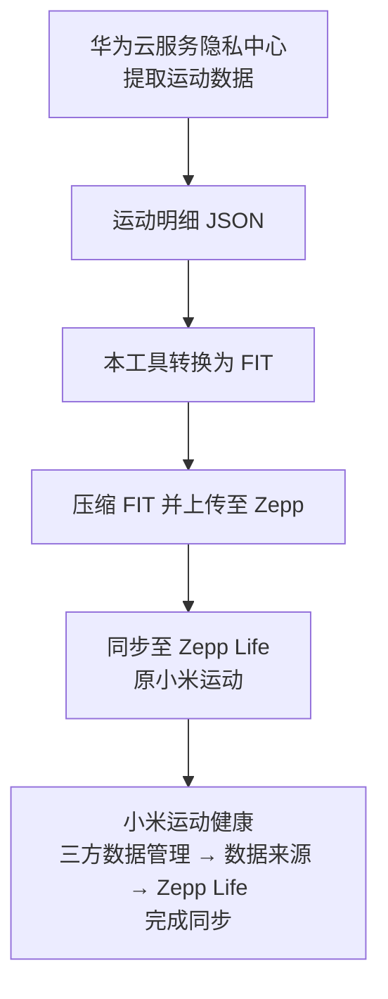

# Huawei Health to FIT

将华为运动健康导出归档中的运动明细 JSON 转换为标准 FIT Activity 文件。提供中文桌面 GUI 和命令行入口，每次运动生成一个 FIT，供支持此格式的平台导入。
由于使用小米系手机与手表手环，后更换为华为系手表，现将华为运动健康的运动数据导入到小米运动健康，导入流程：



## 功能

- 三步向导：选择数据 → 预览筛选 → 导出，每步只显示当前需要的选项，坐标说明、ZIP 打包、运行日志等收在折叠区。
- 自动扫描运动明细分片、按记录 ID 去重并预览运动，扫描完成后自动收起目录设置。
- 按运动类型、快捷时间范围或自定义日期筛选，导出所选记录或全部筛选结果。
- 在“高级选项”中打开 ZIP 打包，导出当前范围并生成只含 FIT 的 ZIP；超过 50 MB 自动分包。
- 选择有轨迹、有明显暂停、无轨迹的代表记录作为测试样本。
- 保存已有心率、步频、海拔、可对齐速度及运动汇总。
- 选择轨迹坐标处理方式；逐条解码并校验 FIT CRC。
- 后台转换、进度显示、取消、重复导出跳过，导出结果按行回填并汇总失败原因与 JSON 报告。
- 跟随系统 / 浅色 / 深色三种外观，设置自动保存。

转换在本地完成。工具负责生成 FIT，Zepp 手机端的实际导入效果需先用样本确认。

## 在 Windows 上运行

需要 Python 3.10 或更高版本及 Tkinter。当前版本已在 Windows、Python 3.14 上验证。首次安装依赖需要网络。

1. 将仓库下载到本地，在仓库目录打开 PowerShell。
2. 创建虚拟环境并安装依赖：

   ```powershell
   powershell -NoProfile -ExecutionPolicy Bypass -File .\setup.ps1
   ```

   如果 Python 没有加入 PATH，可指定安装路径：

   ```powershell
   powershell -NoProfile -ExecutionPolicy Bypass -File .\setup.ps1 -PythonExe "C:\path\to\python.exe"
   ```

   上述 ExecutionPolicy 参数仅对该次 PowerShell 进程生效。

3. 双击 `Start GUI.cmd`，或运行：

   ```powershell
   .\.venv\Scripts\python.exe app.py
   ```

4. 在“选择数据”步骤选中华为导出的 `HUAWEI_HEALTH` 目录（或其中的运动明细目录），工具会自动扫描。
5. 在“预览筛选”步骤核对记录，挑选运动类型与时间范围；需要只导出部分记录时先在列表里选中它们。
6. 进入“导出”步骤：确认输出目录位于源目录之外，导出范围选“测试样本 3 类”，先导出样本。样本位于输出目录的 `samples` 子目录。
7. 在 Zepp 中试导入样本并核对日期、距离、时长、心率和轨迹，再回到“导出”步骤选择“全部筛选”批量导出。

需要批量导入时，展开“高级选项”打开“生成 ZIP 包”。工具会复用已校验的相同 FIT，只打包本次范围对应的成功记录，ZIP 内不包含目录或 JSON 报告。压缩包和解压后的 FIT 总大小均按每包 50,000,000 字节限制分包；多个分包可以分别导入。转换失败的记录不会进入 ZIP，原因保留在报告中。

若使用已打包的 Windows EXE，可直接双击运行，无需单独安装 Python。

## 打包 Windows EXE

在 Windows 上执行：

```powershell
powershell -NoProfile -ExecutionPolicy Bypass -File .\setup.ps1 -BuildTools
powershell -NoProfile -ExecutionPolicy Bypass -File .\build.ps1
```

生成的 `HuaweiHealthToFIT.exe` 位于仓库根目录和 `dist` 目录。分发时附带 `GARMIN_FIT_SDK_LICENSE.txt`。

## 仓库内容

```text
app.py                     GUI / CLI 入口
huawei_fit/core.py         数据扫描、字段映射、FIT 编码、校验和导出
huawei_fit/gui.py          界面兼容入口（转发到 huawei_fit/ui）
huawei_fit/ui/theme.py     颜色、字体与间距令牌，浅色/深色双值
huawei_fit/ui/components.py 卡片、步骤导轨、折叠区、状态条等通用控件
huawei_fit/ui/app.py      三步向导窗口、后台任务与事件循环
requirements.txt          运行依赖
requirements-build.txt    打包依赖
setup.ps1                 Windows 环境安装
Start GUI.cmd             Windows 启动入口
build.ps1                 Windows 打包脚本
docs/cli.md               命令行和坐标选项参考
docs/conversion.md        转换规则、已知限制和验证范围
GARMIN_FIT_SDK_LICENSE.txt 第三方 SDK 许可原文
```

源码仓库不附带个人健康归档、运动样本或转换结果。`.gitignore` 默认排除 JSON、FIT、健康表格、EXE、虚拟环境和构建产物；本地设置与结果报告也不会被正常的 `git add` 纳入。

如需发布可执行程序，可将打包产物作为单独的发行附件。不要对个人数据使用 `git add -f`。

项目依赖 Garmin FIT SDK，其许可原文见随附文件；该文件不代表本项目其他源码的许可证。
