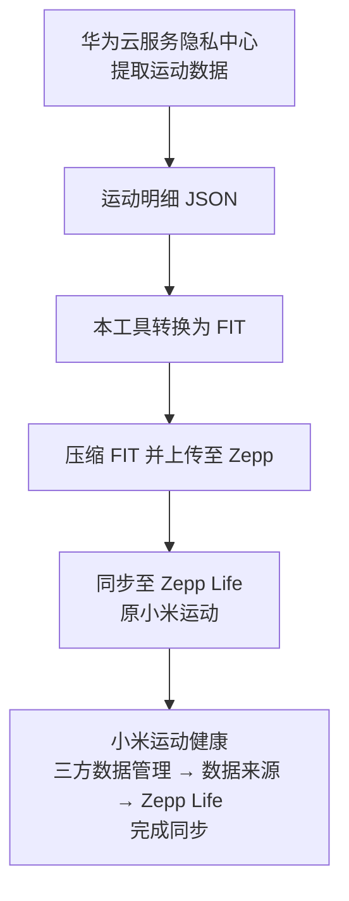

# Huawei Health to FIT

将华为运动健康导出归档中的运动明细 JSON 转换为标准 FIT Activity 文件。提供中文桌面 GUI 和命令行入口，每次运动生成一个 FIT，供支持此格式的平台导入。
由于使用小米系手机与手表手环，后更换为华为系手表，现将华为运动健康的运动数据导入到小米运动健康，导入流程：



## 功能

- 三步向导：选择数据 → 预览筛选 → 导出，每步只显示当前需要的选项，坐标说明、ZIP 打包、运行日志等收在折叠区。
- 自动扫描运动明细分片、按记录 ID 去重并预览运动，扫描完成后自动收起目录设置。
- 按运动类型、快捷时间范围或自定义日期筛选，导出所选记录或全部筛选结果。
- 在“高级选项”中打开 ZIP 打包，导出当前范围并生成只含 FIT 的 ZIP；超过 50 MB 自动分包。
- 选择有轨迹、有明显暂停、无轨迹的代表记录作为测试样本。
- 保存已有心率、步频、海拔、可对齐速度及运动汇总。
- 选择轨迹坐标处理方式；逐条解码并校验 FIT CRC。
- 后台转换、进度显示、取消、重复导出跳过，导出结果按行回填并汇总失败原因与 JSON 报告。
- 跟随系统 / 浅色 / 深色三种外观，设置自动保存。

转换在本地完成。工具负责生成 FIT，Zepp 手机端的实际导入效果需先用样本确认。

## 在 Windows 上运行

需要 Python 3.10 或更高版本及 Tkinter。当前版本已在 Windows、Python 3.14 上验证。首次安装依赖需要网络。

1. 将仓库下载到本地，在仓库目录打开 PowerShell。
2. 创建虚拟环境并安装依赖：

   ```powershell
   powershell -NoProfile -ExecutionPolicy Bypass -File .\setup.ps1
   ```

   如果 Python 没有加入 PATH，可指定安装路径：

   ```powershell
   powershell -NoProfile -ExecutionPolicy Bypass -File .\setup.ps1 -PythonExe "C:\path\to\python.exe"
   ```

   上述 ExecutionPolicy 参数仅对该次 PowerShell 进程生效。

3. 双击 `Start GUI.cmd`，或运行：

   ```powershell
   .\.venv\Scripts\python.exe app.py
   ```

4. 在“选择数据”步骤选中华为导出的 `HUAWEI_HEALTH` 目录（或其中的运动明细目录），工具会自动扫描。
5. 在“预览筛选”步骤核对记录，挑选运动类型与时间范围；需要只导出部分记录时先在列表里选中它们。
6. 进入“导出”步骤：确认输出目录位于源目录之外，导出范围选“测试样本 3 类”，先导出样本。样本位于输出目录的 `samples` 子目录。
7. 在 Zepp 中试导入样本并核对日期、距离、时长、心率和轨迹，再回到“导出”步骤选择“全部筛选”批量导出。

需要批量导入时，展开“高级选项”打开“生成 ZIP 包”。工具会复用已校验的相同 FIT，只打包本次范围对应的成功记录，ZIP 内不包含目录或 JSON 报告。压缩包和解压后的 FIT 总大小均按每包 50,000,000 字节限制分包；多个分包可以分别导入。转换失败的记录不会进入 ZIP，原因保留在报告中。

若使用已打包的 Windows EXE，可直接双击运行，无需单独安装 Python。

如果 Zepp 中的轨迹在途中或终点后突然延伸出很长的直线，请用 v1.1.1 或更新版本重新导出，并先在 Zepp 中试导入单条记录。异常坐标、过滤规则和跨应用同步的验证进度见下方 GPS 异常点说明。

## 打包 Windows EXE

在 Windows 上执行：

```powershell
powershell -NoProfile -ExecutionPolicy Bypass -File .\setup.ps1 -BuildTools
powershell -NoProfile -ExecutionPolicy Bypass -File .\build.ps1
```

生成的 `HuaweiHealthToFIT.exe` 位于仓库根目录和 `dist` 目录。分发时附带 `GARMIN_FIT_SDK_LICENSE.txt`。

## 仓库内容

```text
app.py                     GUI / CLI 入口
huawei_fit/core.py         数据扫描、字段映射、FIT 编码、校验和导出
huawei_fit/gui.py          界面兼容入口（转发到 huawei_fit/ui）
huawei_fit/ui/theme.py     颜色、字体与间距令牌，浅色/深色双值
huawei_fit/ui/components.py 卡片、步骤导轨、折叠区、状态条等通用控件
huawei_fit/ui/app.py      三步向导窗口、后台任务与事件循环
requirements.txt          运行依赖
requirements-build.txt    打包依赖
setup.ps1                 Windows 环境安装
Start GUI.cmd             Windows 启动入口
build.ps1                 Windows 打包脚本
GARMIN_FIT_SDK_LICENSE.txt 第三方 SDK 许可原文
```

源码仓库不附带个人健康归档、运动样本或转换结果。`.gitignore` 默认排除 JSON、FIT、健康表格、EXE、虚拟环境和构建产物；本地设置与结果报告也不会被正常的 `git add` 纳入。

如需发布可执行程序，可将打包产物作为单独的发行附件。不要对个人数据使用 `git add -f`。

项目依赖 Garmin FIT SDK，其许可原文见随附文件；该文件不代表本项目其他源码的许可证。

## 命令行参考

以下命令在仓库根目录运行，使用 `setup.ps1` 创建的虚拟环境。

### 示例

启动 GUI，并指定源目录：

```powershell
.\.venv\Scripts\python.exe app.py --source "D:\health-archive\HUAWEI_HEALTH"
```

只转换最多三条代表性样本：

```powershell
.\.venv\Scripts\python.exe app.py --cli --source "D:\health-archive\HUAWEI_HEALTH" --output ".\exported_fit\samples" --samples
```

转换全部记录：

```powershell
.\.venv\Scripts\python.exe app.py --cli --source "D:\health-archive\HUAWEI_HEALTH" --output ".\exported_fit\all"
```

### 参数

| 参数 | 默认值 | 说明 |
| --- | --- | --- |
| `--source PATH` | CLI 为 `HUAWEI_HEALTH` | 源目录或单个运动明细 JSON 文件；GUI 也可通过对话框选择目录 |
| `--cli` | 关闭 | 不启动窗口，在命令行中扫描并转换 |
| `--output PATH` | `exported_fit` | CLI 的输出目录；GUI 使用界面中选择的输出目录 |
| `--samples` | 关闭 | CLI 只导出代表性样本；输出位置完全由 `--output` 指定 |
| `--coord MODE` | `auto` | CLI 的坐标处理方式；GUI 使用界面中选择的方式 |
| `--help` | — | 显示帮助信息 |

输出目录应位于源目录之外。CLI 在转换失败、源目录无可转换记录或运行错误时返回退出码 `1`，其余成功情况返回 `0`。

### 坐标方式

| MODE | 行为 |
| --- | --- |
| `auto` | 优先读取明确的 GCJ-02 / WGS-84 标记；无标记但来源是 AMAP 时假设为 GCJ-02，并在报告中说明；其他未知坐标系省略 GPS |
| `gcj02` | 指定源坐标为 GCJ-02，转换为 WGS-84；范围外坐标保持原值 |
| `wgs84` | 指定源坐标为 WGS-84，保留原坐标 |
| `omit` | 不导出 GPS，保留其余可用传感器数据和运动汇总 |

### 输出文件

- `日期_时间_运动类型_摘要.fit`：每次运动一个 FIT。
- `export_manifest.json`：成功导出文件的指纹、哈希和限制说明，用于识别重复导出。
- `conversion_report_*.json`：本次任务的成功、跳过、失败、取消状态及各条记录的说明。
- `Zepp_FIT_*.zip`：GUI“导出 ZIP 包”生成的压缩包，必要时带 `_part01` 等分包编号；仅含本次筛选成功或已存在的 FIT。
- `converter_settings.json`：GUI 在应用目录保存的源路径、输出路径和坐标选项。

报告可能包含源文件路径、运动日期和记录 ID。默认不纳入 Git。

## 转换规则和验证范围

### 输入和字段处理

工具递归寻找 `motion path detail data*.json`，读取每个分片中的数组记录。`summaryData` 包含运动汇总，`detailData` 包含带 `tp` 标签的传感器序列。空数组会跳过；无效文件或记录会出现在扫描提示中。

相同记录 ID 保留版本值较高的记录。没有记录 ID 时，以文件路径和数组位置作为扫描键。

时间戳统一为 FIT 的 UTC 时间，并在 Activity 中保存原始时区偏移。距离汇总使用米，热量由 cal 换为 kcal，实时速度由分米/秒换为米/秒，爬升下降由分米换为米。跑步、步行和徒步的步频按两步一个周期写入 FIT cadence。

导出先在内存中完成编码、CRC 检查和解码检查，再通过临时文件写入输出目录。内容和设置相同的已知输出经哈希及完整性验证后跳过；已有文件内容不同则另取文件名，避免覆盖。

### GPS 异常点与轨迹漂移

部分华为归档的 `lbs` 定位样本在轨迹中间或末尾出现固定坐标 `(90.0, -80.0)`（纬度 90°N，经度 80°W）。这组数值落在经纬度的合法范围内，旧版因此把它写入了 FIT。Zepp 绘图时会把相邻的有效点连到北极，导致轨迹出现长直线，地图也随之缩小到洲际尺度。

从 v1.1.1 开始，扫描和转换都会把这组坐标视为占位值。转换在坐标系换算前丢弃该定位样本，保留同一时刻可用的心率、步频等传感器数据。FIT 导出版本也已更新，用新版重新导出时会生成新文件。

### 运动类型

目前明确映射户外跑步、户外步行、户外骑行、登山、徒步、室内跑步、室内骑行、室内步行和羽毛球。未知类型以通用运动导出并记录说明。FIT Profile 没有对应子类型时使用通用子类型，并保留运动名称。

### 已知限制

- 每次运动仅写一个汇总圈，未将原始分公里、分英里配速重建为独立圈。
- 同时保留运动时长与含暂停的总时长。源数据没有明确的暂停事件，因此不推测具体暂停边界；两种时长差超过五秒时，不导出可能错位的相对时间速度序列。
- 不插值补造心率、GPS 或累计距离曲线。总距离保留在 Session 和 Lap 汇总中。
- 无 GPS 的运动仍可导出已有传感器数据及汇总。无任何可用时间采样的记录会报错。
- 自动坐标模式对没有明确标记的 AMAP 数据作 GCJ-02 假设，需要通过地图样本核对。
- 华为专有恢复、训练负荷指标，以及睡眠、全天步数等日常健康数据不在本版本转换范围内。
- FIT 文件通过格式校验不等于目标平台完整支持所有字段。Zepp 中的展示、分类及指标计算仍需实测；本工具不连接或自动上传 Zepp 账号。

### 已完成验证

初始版本使用一批 272 次运动的华为归档完成了全量转换，每条输出通过 SDK 解码和 CRC 校验。八项临时检查覆盖单位和时区换算、独立 CRC、坐标换算、无效采样、暂停时长、重复记录、重复导出、取消以及该归档中的各运动类型，检查通过后已清理临时测试文件。

Windows EXE 已完成启动、记录预览和样本重复导出检查。个人归档和对应 FIT 未包含在本仓库中。

v1.1.1 重新导出并校验了同一批 272 条记录。逐条解码对比确认，从 163 个旧 FIT 中去除了共 243 个异常 GPS 点，其余数据一致。一条出现终点延伸的跑步样本修正后保留了 818 个有效轨迹点，重新导入 Zepp 后轨迹显示正常。Zepp Life 中已同步的旧记录能否替换，以及修正版能否经 Zepp Life 同步至小米运动健康并打开详情，仍待验证。
